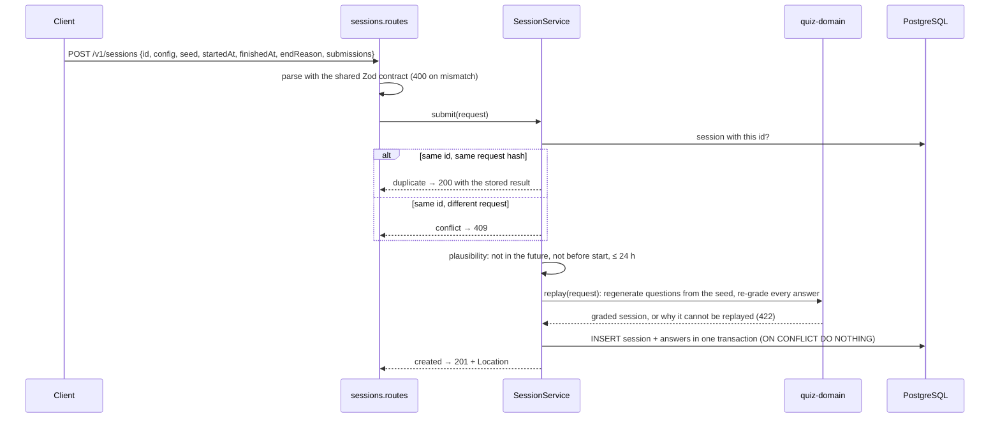
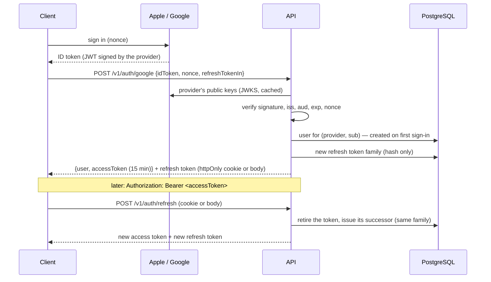
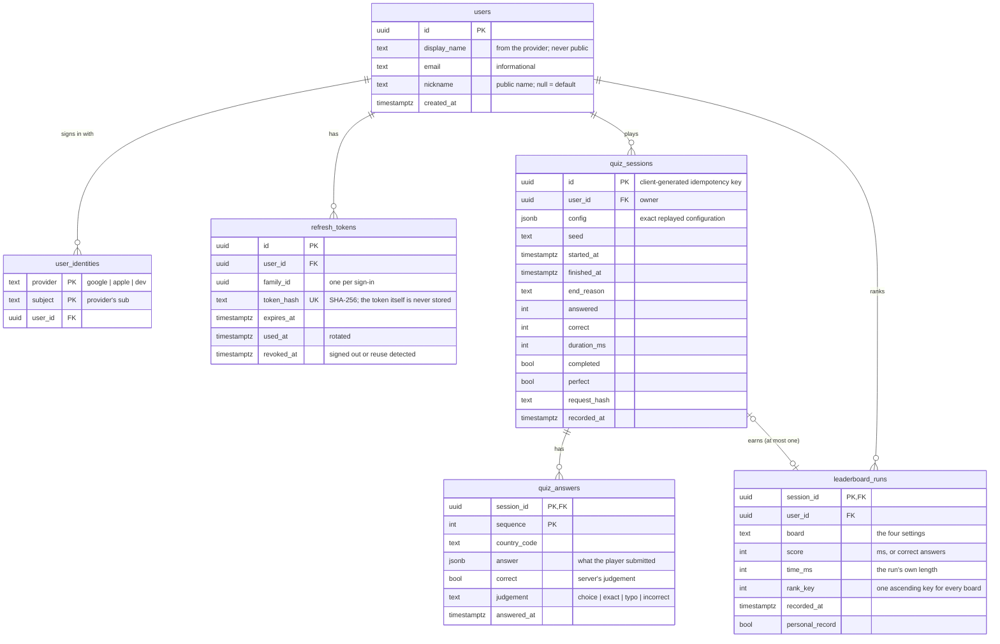

# Backend (API)

> Status: ✅ Phase 6 — Express 5 API, PostgreSQL with Drizzle, migrations,
> finished quiz sessions graded by the server. ✅ Phase 7a — sign-in with
> Google and Apple ID tokens, access/refresh tokens, account deletion; every
> session belongs to a signed-in player.
> ✅ Phase 7b — the app signs in. ✅ Phase 8a — a player's history for
> syncing progress between devices (`GET /v1/sessions`). ✅ Phase 8b — the
> app sends its outbox and pulls the history ([ADR-006](../decisions/ADR-006-local-persistence.md)).
> ✅ Phase 9a/9b — public boards, personal records and nicknames.
> ✅ Phase 9c — the SSR site reads the same boards.
> ✅ Phase 25 — a board is the four settings a quiz is played with, and any
> game in a ranked mode competes ([ADR-014](../decisions/ADR-014-ranked-boards.md));
> `POST /v1/challenges` is gone.

Why PostgreSQL, Drizzle and PGlite: [ADR-005](../decisions/ADR-005-database.md).
Why this sign-in design: [ADR-010](../decisions/ADR-010-authentication.md).

## Structure

```
apps/api/
  drizzle.config.ts        drizzle-kit: schema → SQL migrations
  drizzle/                 generated SQL migrations (committed)
  src/
    main.ts                composition root: config → database → migrate → app → listen
    config.ts              environment, validated with Zod at start-up
    app.ts                 Express app factory (no listen), error handling
    http/problem.ts        RFC 9457 problem-details responses
    http/cors.ts           allow-listed origins, with credentials
    http/cookies.ts        the refresh-token cookie
    auth/
      auth.routes.ts       /v1/auth: google, apple, dev, refresh, logout
      me.routes.ts         /v1/me: read, nickname, records, delete the account
      nickname.ts          the default public name ("Player 4821")
      require-auth.ts      Authorization: Bearer → the user id
      auth-service.ts      sign-in, refresh, sign-out, deletion
      identity-verifier.ts provider ID tokens against their JWKS
      access-tokens.ts     15-minute HS256 JWTs
      refresh-tokens.ts    rotation + reuse detection (hashes only)
      user-repository.ts   users and their provider identities
    db/schema.ts           tables (Drizzle)
    db/database.ts         PostgreSQL (pg) or PGlite behind one Database type
    sessions/
      sessions.routes.ts   HTTP: parse, call the service, map outcomes to status codes
      session-service.ts   the rules: plausibility, replay, idempotency
      session-repository.ts  SQL only
      request-hash.ts      canonical JSON + SHA-256
      history-cursor.ts    opaque keyset cursor of the history
    leaderboard/
      leaderboard.routes.ts  /v1/leaderboards/:board
      leaderboard-service.ts boards, records, the place a run earned
      ranked-run-rules.ts    does a replayed run belong on a board (domain + a plausibility floor)
      leaderboard-repository.ts  the ranking queries
    friends/
      friends.routes.ts      /v1/friends: the lists, requests, a friend's page, the shared board
      friend-service.ts      the rules: who may see whom, a friend's achievements
      friend-repository.ts   one row per relationship, in the direction it was asked
      progress-repository.ts a player's answers as the domain's progress events
      invite-code.ts         the 8-character code an account is found by
    testing/               test database, test API, fake identity provider, a helper that plays real sessions
libs/shared/contracts/     Zod schemas of requests, responses and errors
```

Layers depend inward: routes → service → repository → database. The service
knows the quiz rules (through `quiz-domain`) but no SQL; the repository knows
SQL but no quiz rules. `createApp()` receives its dependencies, so tests use a
manual clock and an in-memory database.

## Recording a session: `POST /v1/sessions`

The client sends **what the player did** — configuration, seed, timestamps and
the answers given — and never a score, correctness or mastery. The request
schema is strict: unknown fields such as `score` are rejected, not ignored.



- **The server grades.** `replay` rebuilds the exact questions from the seed and
  runs every answer through the same matching rules the client used. A choice
  that was not offered, a text answer in Easy mode, answers after the time ran
  out, or an ending that does not match the answers make the whole session
  **rejected** (422) — the server does not "fix" a session.
- **Idempotency.** `id` is a UUID the client generates once per session,
  normalised to lower case (as PostgreSQL stores it). The server stores a
  SHA-256 of the canonical request as parsed by the contract (keys sorted, so
  key order does not matter). Because the parsed request is hashed, a new
  request field must not get a `.default()`: older clients' retries would hash
  differently and get 409. A retry with the same body returns the stored result
  (200); a different body under the same id is a conflict (409). Two identical
  requests racing each other are resolved by the primary key and
  `ON CONFLICT DO NOTHING`: exactly one inserts.
- **One body from before the boards changed is still accepted.** A device that
  finished a leaderboard challenge **offline** holds that request in its
  outbox, written in the `challenge` mode ADR-014 removed. `parsePostedSession`
  (`shared/contracts`) tries today's contract first and then the legacy shape,
  and says the same session in the vocabulary that is left: a quick round over
  the World set of 195 questions, which draws the same questions from the same
  seed, so it replays and grades exactly as it was played. The challenge id it
  answered is dropped — nothing is left to check it against. Such a run is
  **never ranked**: 195 questions is not a quick round's length, and the
  service says so explicitly as well (`SubmitOptions.legacy`). Refusing the
  body instead would mark a real game as rejected and drop its answers from
  the player's progress. Nothing in any shipped app can produce such a body
  any more, so this is a one-way door, not a second contract to keep.
- **Plausibility.** `finishedAt` may be at most 5 minutes ahead of the server
  clock and at most 24 hours after `startedAt`. These bounds stop obviously
  forged timestamps; precise timing for leaderboards is decided in Phase 9.

`GET /v1/sessions/:id` returns the stored result (404 when unknown, 400 when
the id is not a UUID).

## A player's history: `GET /v1/sessions`

What another device needs to rebuild the same progress: every recorded
session of the signed-in player with the **server's** grading of each answer
(country, correct, answer time), oldest recorded first, in pages.

```
GET /v1/sessions?after=<cursor>&limit=50

{ "sessions": [ { id, config, summary, recordedAt, startedAt, finishedAt,
                  answers: [ { countryCode, correct, answeredAt }, … ] }, … ],
  "cursor": "MTcwMDAwMDA2MDAwMDo…", "hasMore": false }
```

- **Why this is enough for progress.** Progress is a deterministic fold over
  answer events ([mastery.md](../domain/mastery.md)); each answer becomes an
  event (category and difficulty from `config`, position in `answers` as the
  sequence). A test plays sessions on "device A", reads them back as
  "device B" and checks that `rebuildProgress` gives the same result.
- **Keyset pagination** on `(recorded_at, id)`, not `OFFSET`: two sessions
  recorded in the same millisecond are neither skipped nor repeated, and
  pages stay cheap as history grows (index `(user_id, recorded_at)`). The
  cursor is opaque base64url; `limit` is 1–100 (default 50); unknown query
  parameters are a 400 like unknown body fields.
- **A cursor is kept, not only followed.** It marks the end of the returned
  page; an empty page returns it unchanged, and sessions recorded later come
  after it. A syncing client stores the last cursor and asks only for what is
  new. `cursor` is `null` only before the first session.
- **Settle window (5 s).** `recordedAt` is taken before the insert commits, so
  a slow insert could land _behind_ a cursor a client already holds. History
  lists only sessions recorded at least 5 seconds ago; by then earlier
  inserts have committed. The device that played a session does not wait —
  it already has it.

### Honest limits

- **Health is liveness only.** `/health` answers without touching the
  database. A readiness check that also runs `SELECT 1` (what an orchestrator
  needs before sending traffic) comes with deployment in Phase 12.
- Only `/v1/auth` is rate-limited (`AUTH_RATE_LIMIT` per client address per
  15 minutes, default 30); general request limits come with deployment
  (Phase 12).
- A page holds up to 100 sessions whatever their length; Endless sessions are
  capped at 1,000 answers each, so the worst page is large but bounded.

## Leaderboards: ranked runs and records

Rules and the trust model: [leaderboard.md](../domain/leaderboard.md). A
board is the four settings a quiz is played with — 56 of them — and there is
nothing to start: an ordinary session in a ranked mode competes on the board
of its own settings ([ADR-014](../decisions/ADR-014-ranked-boards.md)).

| Endpoint                      | Auth   | Does                                                                                                                                                           |
| ----------------------------- | ------ | -------------------------------------------------------------------------------------------------------------------------------------------------------------- |
| `POST /v1/sessions`           | Bearer | Records any session; the result's `ranked` carries the board, score, time, rank, field size and whether it is a personal record — absent when it ranks nothing |
| `GET /v1/leaderboards/:board` | public | The board's best players (`limit` 1–100, default 50) and how many are ranked; `Cache-Control: public, max-age=0, must-revalidate` (always revalidated, ETag)   |
| `GET /v1/me/records`          | Bearer | The player's best ranked run per board, with their nickname, rank and the number of players                                                                    |
| `PATCH /v1/me {nickname}`     | Bearer | Sets the public name                                                                                                                                           |

```mermaid
sequenceDiagram
  participant C as App
  participant A as API
  participant DB as PostgreSQL
  Note over C: plays a quick round or a time attack, with its own seed
  C->>A: POST /v1/sessions {config, seed, timestamps, answers}
  A->>A: replay and grade; evaluateRankedRun; refuse an impossible time
  A->>DB: session + answers + the ranked run, one transaction
  A->>DB: the player's place on that board (row_number over best-per-player)
  A-->>C: 201 {…, ranked: {board, score, timeMs, rank, players, personalRecord}}
```

- **One row per ranked run** (`leaderboard_runs`, keyed by the session), with
  one ascending `rank_key` from the domain's `rankingKey()`: the time on a
  board that ranks by time, the negated count on one that ranks by answers.
  All 56 boards therefore share one `ORDER BY` and one index.
- `personal_record` is decided against the player's best run at the time, and
  stored, so the results screen can say "New personal record" without the
  client working it out. The _current_ best is always a query.
- **Unranked runs are still sessions**: they count for progress and history.
  Nothing is written to `leaderboard_runs` for them.
- **Public board, private identities.** Entries carry rank, nickname, score,
  the run's time and the server's recording time — no user id. The board is
  the same for everyone, which is what lets it be cached; the player's own
  row comes from `/v1/me/records` and is matched by rank, which is unique.
- A retry of the same session is idempotent and returns the same `ranked`.

## Friends: `/v1/friends`

Who may see whom, and why there is no search:
[ADR-015](../decisions/ADR-015-friends.md). Every account carries a permanent
8-character invite code (Crockford base32), handed back by `GET /v1/me` as
`inviteCode`, and that code is the **only** way to be found.

| Endpoint                              | Auth   | Does                                                                                                                         |
| ------------------------------------- | ------ | ---------------------------------------------------------------------------------------------------------------------------- |
| `GET /v1/friends`                     | Bearer | The three lists: `friends`, `incoming` (waiting for this player's answer) and `outgoing`                                     |
| `POST /v1/friends/requests {code}`    | Bearer | Asks the owner of an invite code; `201 {status: 'requested' \| 'accepted', friend}` — `accepted` when they had already asked |
| `POST /v1/friends/:id/accept`         | Bearer | Accepts a waiting request; `404` when there is none from that player                                                         |
| `DELETE /v1/friends/:id`              | Bearer | Declines a request or ends a friendship — the same act, `204` either way, quiet about a player who was never there           |
| `GET /v1/friends/:id`                 | Bearer | A friend's page: nickname, their best run per board, their achievements. `404` to everyone who is not their friend           |
| `GET /v1/friends/leaderboards/:board` | Bearer | The public board's ranking narrowed to the player and their friends, numbered from 1                                         |

- **One row per relationship** (`friendships`, primary key on the pair) in the
  direction it was asked, so both players are found by looking at both
  columns. Asking somebody who has already asked you **accepts their row**
  instead of inserting a second one, which is also what makes two
  simultaneous requests safe: the primary key leaves one standing and the
  repository looks again.
- **404, never 403**, for a player who is not a friend: whether an id exists
  is itself private. An id that is not even a UUID gets the same answer.
- Every response is `Cache-Control: no-store` — these are personal lists that
  change the moment somebody presses a button.
- The **invite code** is validated by the contract (`inviteCodeSchema`), which
  normalises what was typed first: case is ignored, spaces and dashes are
  dropped, `I`/`L` read as `1` and `O` as `0`. A code nobody holds is `404`; a
  player's own code is `400`.
- A **friend's achievements** are computed on request from their stored
  answers with the same domain functions the device uses — `rebuildProgress`
  over `progress-repository.events()`, then `evaluateAchievements`. Nothing
  about mastery is stored on either side.
- The **shared board** is `leaderboardRepository.board(board, limit, among)`:
  the same `DISTINCT ON` + `row_number()` query with
  `user_id IN (player, …friends)`. No friends is a board of one; a set with no
  ranked run is `{players: 0, entries: []}`.
- A deleted account leaves every friends list by itself (the rows cascade with
  the user).

## Signing in: `/v1/auth` and `/v1/me`



| Endpoint                         | Does                                                                                           |
| -------------------------------- | ---------------------------------------------------------------------------------------------- |
| `POST /v1/auth/google`, `/apple` | Verifies the provider ID token, signs in (creating the user on first sign-in)                  |
| `POST /v1/auth/dev`              | Development/E2E sign-in with any subject; only with `AUTH_DEV_LOGIN=true`, never in production |
| `POST /v1/auth/refresh`          | Rotates the refresh token (body for native, cookie for web)                                    |
| `POST /v1/auth/logout`           | Revokes the refresh token's family, clears the cookie                                          |
| `GET /v1/me`                     | The signed-in user                                                                             |
| `DELETE /v1/me`                  | Deletes the account with everything it owns                                                    |

- **Refresh tokens rotate with reuse detection.** A token that was already
  exchanged, presented again, revokes its whole family — the thief and the
  user both have to sign in again. Two simultaneous refreshes with the same
  token therefore sign the client out; the client serialises refreshes.
- **Cookie** (`wq_refresh`): `HttpOnly`, `SameSite=Strict`,
  `Path=/v1/auth`, `Secure` in production (`COOKIE_SECURE`). Scripts cannot
  read it, other sites cannot send it, other endpoints never receive it.
- **CORS** allows credentials only for `CORS_ORIGINS` (by default
  `http://localhost:4200` outside production, nothing in production), and
  the methods `GET, POST, PATCH, DELETE` — every method a route uses, or
  browsers refuse it after the preflight (supertest sends none, so a test
  checks the preflight itself).
- **Sign-in failures are vague** (401 "could not be verified"): which check
  failed helps an attacker more than a client.
- `/v1/sessions` and `/v1/me` require `Authorization: Bearer`. A player reads
  only their own sessions; someone else's session id is a 409 on write and a
  404 on read. After an account is deleted, its still-valid access token gets
  401 when it tries to record a session or read `/v1/me`.

## Errors

Every error is an [RFC 9457](https://www.rfc-editor.org/rfc/rfc9457) problem
document (`application/problem+json`), described by `problemDetailsSchema` in
`shared/contracts`:

| Status | When                                                                                                                                           |
| ------ | ---------------------------------------------------------------------------------------------------------------------------------------------- |
| 400    | Body breaks the contract (with `errors: [{path, message}]`), malformed JSON, malformed id                                                      |
| 401    | Missing, invalid or expired access token (`WWW-Authenticate: Bearer`); unverifiable ID token; invalid or reused refresh token; deleted account |
| 404    | Unknown session, leaderboard or route                                                                                                          |
| 409    | Session id already used by a different session                                                                                                 |
| 413    | Body larger than 256 kB                                                                                                                        |
| 422    | Well-formed session the server cannot verify; `type` names the reason, e.g. `urn:world-quiz:session-rejected:inconsistent-ending`              |
| 429    | Too many requests to `/v1/auth` from one client                                                                                                |
| 503    | Sign-in with a provider that has no client id configured                                                                                       |
| 500    | Anything unexpected: logged on the server, generic message to the client                                                                       |

## Database



- Category, difficulty, mode and scope are also stored as columns for queries
  (leaderboards, statistics); `config` keeps the exact replay input.
- The database enforces invariants too: `correct <= answered`,
  `duration_ms >= 0`, answers cascade-delete with their session.
- Enumerations are `text`, validated at the API boundary against the domain
  vocabulary. PostgreSQL enums would make adding a mode a migration.

### Migrations

```bash
npx nx run api:db-generate   # after changing src/db/schema.ts
```

drizzle-kit compares the schema with the last snapshot in `drizzle/meta` and
writes a new SQL file. Review it like code and commit it. The API applies
pending migrations when it starts; tests apply all of them to a fresh
in-memory database.

## Tests on PGlite and on PostgreSQL

API tests (`npx nx test api`) use an in-memory PGlite by default — the same
in CI. To run the same suite against a PostgreSQL server:

```bash
TEST_DATABASE_URL=postgres://localhost:5432/world_quiz npx nx test api
```

Each test file then creates its own temporary database on that server
(`world_quiz_test_<random>`), applies the migrations and drops it at the end,
so test files can run in parallel. The user needs the `CREATEDB` privilege
(Homebrew's default user has it). `TEST_DATABASE_URL` is part of the Nx cache
key, so a PostgreSQL run never reuses a PGlite result.

PostgreSQL is where concurrency is real: the test "records two identical
requests that race each other exactly once" exercises the primary key and
`ON CONFLICT DO NOTHING`; on PGlite the same test passes because queries run
one at a time.

## Running

```bash
npm run start:api   # http://localhost:3333 — PGlite in .data/pglite, no setup needed
DATABASE_URL=postgres://localhost:5432/world_quiz npm run start:api   # a PostgreSQL server
```

Variables: [environment.md](../development/environment.md).
